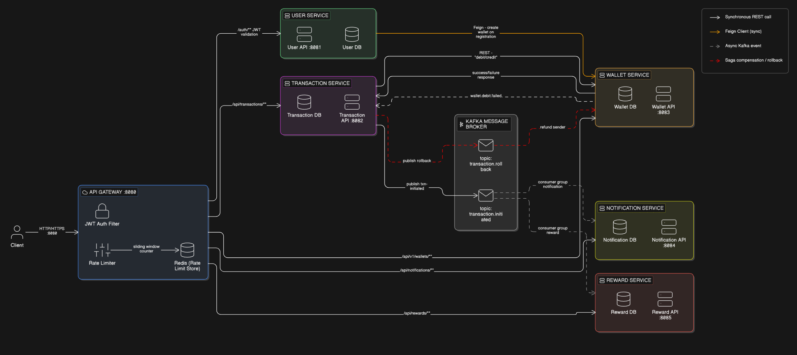

<div align="center">

# 💳 PayFlux

**A microservices-based payment system built with Spring Boot & Kafka**


</div>

---


## Quickstart

```bash
# 1. Configure local container settings and credentials
cp .env.example .env
# Edit .env: set DB_PASSWORD and a random JWT_SECRET (at least 32 bytes)

# 2. Build and start the complete local stack
docker compose -f docker-compose.yml -f docker-compose.local.yml up --build
```

```bash
# 3. Open http://localhost:3000 and try the API (gateway on http://localhost:8080)
POST /auth/signup          # create user + wallet
POST /auth/login           # get JWT token
POST /api/transactions/create   # transfer money (JWT required)
GET  /api/notifications/{userId}
GET  /api/rewards/user/{userId}
```

### Key Features

| Feature | Description |
|---------|-------------|
| Microservices | 6 independent Spring Boot services |
| JWT Auth | Token-based auth enforced at the API Gateway |
| Transactions | Debit/credit with automatic compensation on failure |
| Kafka Events | Async notifications & rewards via `txn-initiated` topic |
| Concurrency | Pessimistic locking on wallet operations |
| Hold/Capture | 2-phase wallet mechanism (pre-auth style) |

---

## Architecture

### Services & Ports

| Service | Port   | Role |
|---------|--------|------|
| API Gateway | `8080` | Routing, JWT validation, rate limiting |
| User Service | `8081` | Signup, login, JWT issuance |
| Transaction Service | `8082` | Money transfers, Kafka producer |
| Wallet Service | `8083` | Balances, holds, debit/credit |
| Notification Service | `8084` | Kafka consumer — stores notifications |
| Reward Service | `8085` | Kafka consumer — assigns reward points |
| Kafka | `9092` | Event broker (Docker) |
| Zookeeper | `2181` | Kafka coordination (Docker) |

All services use **H2 in-memory** databases.

### Tech Stack


### Service Communication

```
Client ──▶ API Gateway (8080)
               ├── /auth/**            ──▶ User Service (8081)
               ├── /api/transactions/** ──▶ Transaction Service (8082)
               ├── /api/v1/wallets/**  ──▶ Wallet Service (8083)
               ├── /api/notifications/**──▶ Notification Service (8084)
               └── /api/rewards/**     ──▶ Reward Service (8085)

User Service ──[Feign]──▶ Wallet Service        (auto-create wallet on signup)
Transaction Service ──[REST]──▶ Wallet Service   (debit/credit on transfer)
Transaction Service ──[Kafka: txn-initiated]──▶ Notification + Reward Services
```

### System Architecture Diagram



---

## Running the System

### Local Docker Compose

```bash
docker compose -f docker-compose.yml -f docker-compose.local.yml up --build
```

Starts the frontend, API gateway, all five domain services, PostgreSQL, Redis,
and Kafka. PostgreSQL, Redis, and Kafka are private to the Docker network. For this
local-only profile the gateway and frontend are bound to `127.0.0.1`.

## Deploy to AWS (EKS + EC2 data host)

`terraform/server` provisions an `m7i-flex.large` EC2 data host and an EKS
cluster with one `m7i-flex.large` worker. Docker Compose runs PostgreSQL, Redis,
and single-node Kafka on EC2. Application workloads run in EKS and use public
GHCR images. No MSK, RDS, ElastiCache, NAT Gateway, or ECR is used.

> AWS charges may still apply for EKS control-plane hours, EC2, EBS, public IPv4,
> and data transfer. Review the Terraform plan and current pricing before apply.
>
> This is a **demo** architecture, not suitable for processing real money. Its
> Kafka/PostgreSQL data are on a single server, Kafka is single-node PLAINTEXT,
> there is no high availability or managed backup, and anyone can sign up via the
> demo API. Do not expose real payment data, card information, or production
> credentials. Add durable encrypted off-host backups and security review before
> any production use. AWS Free plan limitations can still prevent provisioning;
> the Terraform AWS Free Tier AMI is required and the operator must separately
> verify that the selected EC2 size is allowed.

### Launch from Windows PowerShell

Prerequisites: Docker is only required if you also want to run it locally; for
provisioning install the AWS CLI, Terraform CLI, and Windows OpenSSH Client, and
configure AWS CLI credentials for the intended AWS account. The current CLI
identity is shown before any Terraform plan or apply. Do not add credentials to
the repository.

From the repository root, generate a dedicated SSH key if you do not already have
`$HOME\.ssh\payflux-server-ed25519.pub`, then **review the account, region,
Terraform plan, EC2 reference price, and your actual AWS pricing/credits**:

```powershell
powershell -ExecutionPolicy Bypass -File .\deploy\aws-server.ps1
```

Type `YES` to review/apply the planned resources, then type `COST` to acknowledge
that the infrastructure incurs charges. The script then reports the EC2 public
IP; no application containers run on that host. Start the data services with:

```bash
cd /opt/payflux
sudo bash ./deploy.sh
```

The persistent `deploy/server.env` contains the data-service credentials and is
mode `0600`; Docker stores PostgreSQL, Redis, and Kafka data in named volumes.
Apply the EKS workloads as described in [`k8s/README.md`](k8s/README.md).

To remove the AWS resources created by this **separate** server Terraform root,
inspect the destroy plan and then explicitly confirm it (this will also delete
the EC2 root disk and server volumes):

```powershell
terraform -chdir=terraform/server destroy -var-file=deploy/server-config.tfvars
```

Deleting server resources destroys the only copy of this demo database/Kafka
data unless you have created a backup.

### 2. Start Services

Run each in a separate terminal (or from your IDE):

```bash
cd api-gateway          && mvn spring-boot:run
cd user-service         && mvn spring-boot:run
cd wallet-service       && mvn spring-boot:run
cd transaction-service  && mvn spring-boot:run
cd notification-service && mvn spring-boot:run
cd reward-service       && mvn spring-boot:run
```

> **Note:** Rate limiting requires Redis on the default port. Without it, disable the rate limiter in gateway config.

---

## Request Flows

### Signup — `POST /auth/signup`

1. Gateway allows without JWT.
2. **User Service** validates email uniqueness, saves user, then calls **Wallet Service** (Feign) to auto-create a wallet.
3. If wallet creation fails, the user is deleted (rollback).

### Login — `POST /auth/login`

1. Gateway allows without JWT.
2. **User Service** verifies credentials (BCrypt), returns a JWT containing `userId`, `email`, `role`.
3. Use the token as `Authorization: Bearer <token>` for all other endpoints.

### Gateway JWT Filter

- Public paths (`/auth/signup`, `/auth/login`) — no token needed.
- Everything else — validates JWT, injects `X-User-Email`, `X-User-Id`, `X-User-Role` headers, or returns **401**.

### Money Transfer — `POST /api/transactions/create`

1. Creates a `PENDING` transaction.
2. **Debits** sender wallet — if it fails, marks `FAILED`.
3. **Credits** receiver wallet — if it fails, **refunds sender**, marks `FAILED`.
4. On success, publishes to Kafka topic `txn-initiated`.

### Notifications & Rewards (async via Kafka)

- **Notification Service** consumes `txn-initiated`, stores a notification record.
- **Reward Service** consumes the same topic (different consumer group), assigns `amount × 100` reward points. Deduplicates by `transactionId`.

### Wallet Endpoints

| Method | Endpoint | Description |
|--------|----------|-------------|
| POST | `/api/v1/wallets` | Create wallet |
| POST | `/api/v1/wallets/credit` | Credit money |
| POST | `/api/v1/wallets/debit` | Debit money |
| GET | `/api/v1/wallets/{userId}` | Get wallet |
| POST | `/api/v1/wallets/hold` | Place a hold (reserve funds) |
| POST | `/api/v1/wallets/capture` | Capture a held amount |
| POST | `/api/v1/wallets/release/{holdReference}` | Release a hold |

> Hold/capture is a 2-phase mechanism (like card pre-auth). Currently unused by the transfer flow but available for future use.

---

## Edge Cases & Error Handling

| Scenario | Behavior |
|----------|----------|
| Duplicate email on signup | Error returned, no user created |
| Wallet creation fails on signup | User is deleted (rollback) |
| Invalid/missing JWT | Gateway returns **401** |
| Insufficient funds | Transaction marked `FAILED` |
| Sender wallet not found | Transaction marked `FAILED` |
| Credit to receiver fails | Sender refunded, transaction marked `FAILED` |
| Kafka publish fails | Transaction stays `SUCCESS`; notifications/rewards may be missing |
| Duplicate Kafka event | Reward service deduplicates by `transactionId` (unique constraint) |
| Concurrent wallet ops | Pessimistic locking prevents race conditions |
| Insufficient balance for hold | Error thrown |

---

## Project Map

<details>
<summary><b>Click to expand full file locations</b></summary>

| Service | Key Files |
|---------|-----------|
| **API Gateway** | `application.yml` · `JwtAuthFilter.java` · `RateLimitConfig.java` · `JWTUtil.java` |
| **User Service** | `AuthController` · `UserController` · `UserServiceImpl` · `WalletClient.java` (Feign) |
| **Wallet Service** | `WalletController` · `WalletServiceImpl` · `Wallet` / `WalletHold` entities |
| **Transaction Service** | `TransactionController` · `TransactionServiceImpl` · `KafkaEventProducer` |
| **Notification Service** | `NotificationController` · `NotificationConsumer` (Kafka) |
| **Reward Service** | `RewardController` · `RewardConsumer` (Kafka) · `RewardRepository` |

</details>

## CI

`.github/workflows/ci.yml` runs the Maven service tests with containerized
PostgreSQL, Redis, and Kafka, builds the frontend, and publishes application
images to GHCR. It does not authenticate to AWS or deploy Kubernetes resources.

---

## Future Improvements

- Replace H2 with **PostgreSQL / MySQL**
- Use **hold/capture** flow for transfers
- Send notifications to **receiver** (not just sender)
- Add **service discovery** (Eureka / Consul)
- Externalize JWT secret to environment variables
